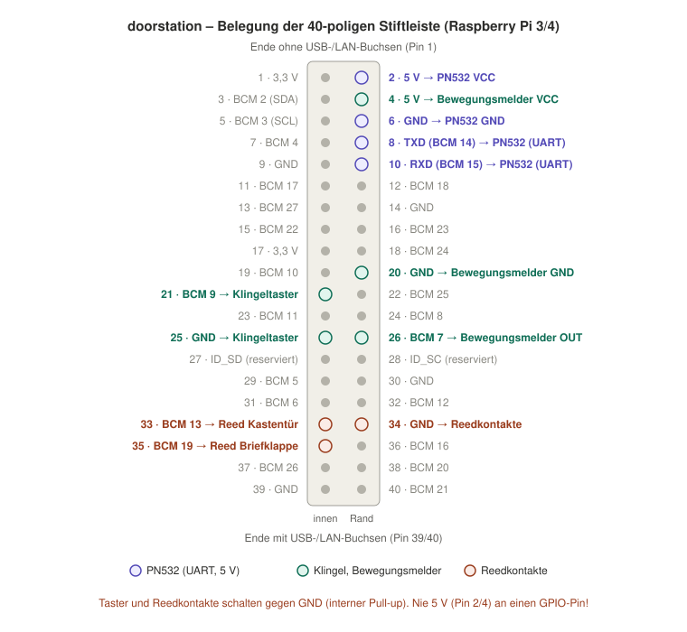

# Hardware

## Komponenten

| Komponente | Verwendet | Hinweise |
|---|---|---|
| Raspberry Pi | Pi 3 Model B oder Pi 4 | Gleiche Stiftleiste; dieselbe SD-Karte läuft auf beiden. Netzteil Pi 3: 5 V / 2,5 A (Micro-USB), Pi 4: 5 V / 3 A (USB-C). |
| NFC-Leser | Elechouse NFC Module V3 (PN532) bzw. Nachbau | Betrieb per UART (HSU), VCC an **5 V**. Bei schlechter Home-Key-Erkennung: Elechouse PN532 V4. |
| USB-Soundkarte | C-Media USB Audio (z. B. `0d8c:000c`, `0d8c:0014`) | Getrennte 3,5-mm-Buchsen für Lautsprecher und Mikrofon. |
| Lautsprecher | kleiner Lautsprecher an der Kopfhörerbuchse | Ein Klangvolumen (Gehäuse) hinter dem Lautsprecher verbessert den Klang deutlich. |
| Mikrofon | Elektret-Mikrofon mit 3,5-mm-Stecker | Abstand zum Lautsprecher so groß wie möglich (weniger Echo). |
| Klingeltaster | Taster, schaltet gegen GND | |
| Reedkontakte | 2 Stück für Briefklappe und Kastentür, schalten gegen GND | Öffner oder Schließer – die Logik stellt `active` in der Konfiguration ein. |
| Bewegungsmelder | HC-SR501 (PIR) | Versorgung 5 V, Ausgang 3,3 V. Haltezeit (Poti „Tx“) und Retrigger-Jumper am Modul. |

## Belegung der Stiftleiste

Pin-Nummern sind physische Pins, dazu die BCM-Nummer, die die Konfiguration verwendet. **Orientierung:** Pin 1 liegt am Ende der Leiste **ohne** USB-/LAN-Buchsen in der **inneren** Reihe (eckiger Lötpunkt). Ungerade Pins = innen, gerade = Platinenrand.

| Pin | Funktion | Angeschlossen an |
|---|---|---|
| 2 | 5 V | PN532 VCC |
| 4 | 5 V | Bewegungsmelder VCC |
| 6 | GND | PN532 GND |
| 8 | BCM 14 · TXD | PN532 UART |
| 10 | BCM 15 · RXD | PN532 UART |
| 20 | GND | Bewegungsmelder GND |
| 21 | BCM 9 | Klingeltaster |
| 25 | GND | Klingeltaster |
| 26 | BCM 7 | Bewegungsmelder OUT |
| 33 | BCM 13 | Reedkontakt Kastentür |
| 34 | GND | Reedkontakte (gemeinsame Masse) |
| 35 | BCM 19 | Reedkontakt Briefklappe |

**Nie 5 V (Pin 2/4) an einen GPIO-Pin legen** – die GPIOs vertragen nur 3,3 V.

## Verschaltung je Bauteil

### PN532 (UART)

| PN532 | → | Pi-Pin |
|---|---|---|
| VCC | → | Pin 2 (5 V) |
| GND | → | Pin 6 (GND) |
| TXD | → | Pin 10 (RXD) |
| RXD | → | Pin 8 (TXD) |

- **DIP-Schalter auf HSU (UART)** – bei V3-Modulen beide auf 0/OFF (Aufdruck auf der Platine).
- **TX/RX gekreuzt.** Die Beschriftung mancher Nachbauten ist vertauscht: Kommt keine Antwort vom Leser, die beiden Datenleitungen tauschen – das schadet nicht.
- **VCC an 5 V:** Das V3-Modul hat einen eigenen 3,3-V-Regler (VCC 3,3–5,5 V, TXD/RXD bleiben 3,3 V). An 3,3 V treten nach Lesevorgängen häufig Übertragungsfehler auf. **5 V nur bei Modulen mit Regler.**
- Auf dem Pi: `enable_uart=1`, `dtoverlay=disable-bt`, serielle Konsole aus – erledigt `install.sh`. Der Leser ist dann `/dev/ttyAMA0`.

### Klingeltaster und Reedkontakte

Jeweils zwischen GPIO-Pin und GND. In `/etc/doorstation/gpio.yaml`: `pull: up` (interner Pull-up), `active: low` – ein geschlossener Kontakt zieht den Pin auf 0 V.

| Eingang | GPIO | GND |
|---|---|---|
| Klingel | Pin 21 (BCM 9) | Pin 25 |
| Kastentür | Pin 33 (BCM 13) | Pin 34 |
| Briefklappe | Pin 35 (BCM 19) | Pin 34 |

- **Reedkontakte:** Je nach Bauart und Montage ist der Kontakt bei geschlossener Klappe offen oder geschlossen. Die Beispielkonfiguration (`active: low`) meldet `open`, wenn der Kontakt geschlossen ist, d. h. der Pin auf 0 V liegt. Passt das nicht, `active: high` setzen. Prüfen mit `pinctrl get 13,19` (Raspberry Pi OS 13; früher `raspi-gpio`) bei offener und geschlossener Klappe.
- Externe Pull-up-Widerstände (z. B. 10 kΩ gegen 3,3 V) sind bei langen Leitungen sinnvoll; der interne Pull-up stört dabei nicht.

### Bewegungsmelder HC-SR501

| HC-SR501 | → | Pi-Pin |
|---|---|---|
| VCC | → | Pin 4 (5 V) |
| OUT | → | Pin 26 (BCM 7) |
| GND | → | Pin 20 (GND) |

Der Ausgang liefert bei Bewegung 3,3 V (`active: high`, `pull: off`). Häufiges Auslösen über die Haltezeit am Modul und `min_interval_s` dämpfen.

### Audio

USB-Soundkarte an einen USB-Port, Lautsprecher an die Kopfhörerbuchse, Mikrofon an die Mikrofonbuchse. Die eingebauten Audioausgänge des Pi (Klinke, HDMI) schaltet `install.sh` ab – die USB-Karte ist dann das einzige Audiogerät. Reglernamen unterscheiden sich je Stick: `sudo ./install.sh audio-info`, dann `/etc/doorstation/audio.yaml` anpassen (siehe [dienste/sip.md](dienste/sip.md)).
