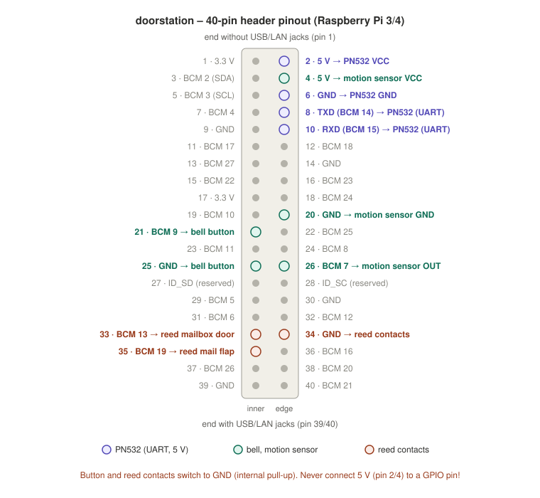

**English** | [Deutsch](de/hardware.md)

# Hardware

## Components

| Component | Used | Notes |
|---|---|---|
| Raspberry Pi | Pi 3 Model B or Pi 4 | Same header; the same SD card runs on both. Power supply Pi 3: 5 V / 2.5 A (Micro-USB), Pi 4: 5 V / 3 A (USB-C). |
| NFC reader | Elechouse NFC Module V3 (PN532) or clone | UART mode (HSU), VCC to **5 V**. If Home Key detection is poor: Elechouse PN532 V4. |
| USB sound card | C-Media USB Audio (e.g. `0d8c:000c`, `0d8c:0014`) | Separate 3.5 mm jacks for speaker and microphone. |
| Speaker | small speaker on the headphone jack | An enclosure behind the speaker improves the sound considerably. |
| Microphone | electret microphone with 3.5 mm plug | Keep it as far from the speaker as possible (less echo). |
| Bell button | push button, switches to GND | |
| Reed contacts | 2 for the mail flap and the mailbox door, switch to GND | Normally closed or normally open – `active` in the configuration sets the logic. |
| Motion sensor | HC-SR501 (PIR) | Supply 5 V, output 3.3 V. Hold time (pot "Tx") and retrigger jumper on the module. |

## Header pinout

Pin numbers are physical pins, plus the BCM number used by the configuration. **Orientation:** pin 1 is at the end of the header **without** the USB/LAN jacks, in the **inner** row (square solder pad). Odd pins = inner row, even pins = board edge.

| Pin | Function | Connected to |
|---|---|---|
| 2 | 5 V | PN532 VCC |
| 4 | 5 V | motion sensor VCC |
| 6 | GND | PN532 GND |
| 8 | BCM 14 · TXD | PN532 UART |
| 10 | BCM 15 · RXD | PN532 UART |
| 20 | GND | motion sensor GND |
| 21 | BCM 9 | bell button |
| 25 | GND | bell button |
| 26 | BCM 7 | motion sensor OUT |
| 33 | BCM 13 | reed contact mailbox door |
| 34 | GND | reed contacts (common ground) |
| 35 | BCM 19 | reed contact mail flap |

**Never connect 5 V (pin 2/4) to a GPIO pin** – the GPIOs only tolerate 3.3 V.

## Wiring per part

### PN532 (UART)

| PN532 | → | Pi pin |
|---|---|---|
| VCC | → | pin 2 (5 V) |
| GND | → | pin 6 (GND) |
| TXD | → | pin 10 (RXD) |
| RXD | → | pin 8 (TXD) |

- **DIP switches to HSU (UART)** – on V3 modules both to 0/OFF (printed on the board).
- **TX/RX crossed.** Some clones have the labels swapped: if the reader does not answer, swap the two data lines – it does no harm.
- **VCC to 5 V:** the V3 module has its own 3.3 V regulator (VCC 3.3–5.5 V, TXD/RXD stay at 3.3 V). At 3.3 V, transmission errors after reads are common. **5 V only for modules with a regulator.**
- On the Pi: `enable_uart=1`, `dtoverlay=disable-bt`, serial console off – `install.sh` does this. The reader is then `/dev/ttyAMA0`.

### Bell button and reed contacts

Each between the GPIO pin and GND. In `/etc/doorstation/gpio.yaml`: `pull: up` (internal pull-up), `active: low` – a closed contact pulls the pin to 0 V.

| Input | GPIO | GND |
|---|---|---|
| Bell | pin 21 (BCM 9) | pin 25 |
| Mailbox door | pin 33 (BCM 13) | pin 34 |
| Mail flap | pin 35 (BCM 19) | pin 34 |

- **Reed contacts:** depending on type and mounting, the contact is open or closed with the flap shut. The example configuration (`active: low`) reports `open` when the contact is closed, i.e. the pin is at 0 V. If that does not fit, set `active: high`. Check with `pinctrl get 13,19` (Raspberry Pi OS 13; formerly `raspi-gpio`) with the flap open and closed.
- External pull-up resistors (e.g. 10 kΩ to 3.3 V) are useful for long wires; the internal pull-up does not interfere.

### HC-SR501 motion sensor

| HC-SR501 | → | Pi pin |
|---|---|---|
| VCC | → | pin 4 (5 V) |
| OUT | → | pin 26 (BCM 7) |
| GND | → | pin 20 (GND) |

The output delivers 3.3 V on motion (`active: high`, `pull: off`). Damp frequent triggering with the module's hold time and `min_interval_s`.

### Audio

USB sound card in a USB port, speaker on the headphone jack, microphone on the microphone jack. `install.sh` disables the Pi's built-in audio outputs (jack, HDMI) – the USB card is then the only audio device. Control names differ per stick: `sudo ./install.sh audio-info`, then adjust `/etc/doorstation/audio.yaml` (see [services/sip.md](services/sip.md#audio)).
